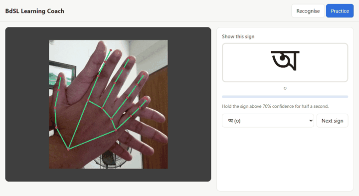

# BdSL Learning Coach

Recognise **Bangla Sign Language (BdSL)** letter and digit signs from your webcam, entirely in the browser. Behind the demo is a small, controlled study for a Neural Network lab. It compares two approaches on the same leakage-aware splits of the BDSL 49 dataset:

- **Approach A, CNNs on images:** a small custom CNN trained from scratch, and an ImageNet-pretrained **MobileNetV3-small** fine-tuned on our data.
- **Approach B, hand landmarks + MLP:** Google **MediaPipe** finds 21 3D keypoints per hand, and a 74k-parameter **MLP** trained from scratch classifies the normalised keypoints.

**Live demo:** https://yousuf-fahim.github.io/bdsl-coach/ (open on a device with a webcam and allow the camera. Deploy steps are in [docs/DEPLOY.md](docs/DEPLOY.md))



*The GIF shows the real built app and its real predictions. The "camera" is a video made from random validation images (`src/make_fake_camera.py`), not a live signer.*

## Results (test set, 2,200 images, evaluated once)

| | Custom CNN | MobileNetV3-small | Landmark MLP |
|---|---|---|---|
| Accuracy, all test images | 73.2% | **97.2%** | 68.6% (no hand found = error) |
| Accuracy, images where MediaPipe found a hand (1,995) | 73.3% | 97.3% | 75.7% |
| Macro F1, all images | 0.728 | 0.972 | 0.712 |
| Parameters | 401k | 1.57M | **74k** |
| Model file | 1.6 MB | 6.2 MB | **0.3 MB** (+7.6 MB MediaPipe model) |
| CPU latency, classifier only (batch 1, 1 thread) | 4.2 ms | 2.6 ms | **0.05 ms** |
| CPU latency, end-to-end incl. MediaPipe | n/a | n/a | 15.4 ms |

Sources: [`results/comparison.csv`](results/comparison.csv), with 95% bootstrap intervals in [`results/comparison_ci.csv`](results/comparison_ci.csv). The plain-language reading is in [`results/comparison_interpretation.md`](results/comparison_interpretation.md). Robustness, error analysis and own-webcam results are in the [report](docs/report.md).

**In one sentence:** the pretrained CNN is far more accurate on this dataset. The landmark MLP ties the from-scratch CNN on images where a hand is detected, using 1/5 of its parameters, but MediaPipe detection failures (about 9% of test images) cost it overall.

**Robustness:** under noise, blur, lighting changes, rotation, occlusion and JPEG compression, MobileNet stayed the most accurate at every severity. Approach B mostly failed because MediaPipe stopped detecting the hand ([`results/robustness_summary.csv`](results/robustness_summary.csv)). **Own-webcam test (new person and room): PENDING** (`src/capture_own.py` → `src/eval_own.py`).

Full write-up: [docs/report.md](docs/report.md) ([PDF](docs/report.pdf)). Viva notes: [docs/viva-cheatsheet.md](docs/viva-cheatsheet.md).

## Repository map

| Path | What |
|---|---|
| `src/` | every script that produces a number or figure (see "Reproduce") |
| `results/` | all CSV/JSON/PNG outputs cited in the report |
| `models/` | trained checkpoints (`*.pt`), `landmark_mlp.onnx`, the MediaPipe `hand_landmarker.task` |
| `web/` | the static web demo (Vite, MediaPipe Tasks Vision, ONNX Runtime Web) |
| `docs/` | report, viva cheat sheet, learning log, deploy guide, decisions (`QUESTIONS.md`), status |
| `data/processed/` | `labels.json`, `splits.csv`, `inventory.csv` (raw images are not committed) |

## Reproduce

Tested on Windows 11, Python 3.13.3, Node 25 (Node 20.19+ works), CPU only. Seed 42 everywhere.

```powershell
# 1. Environment
py -3.13 -m venv .venv
.venv\Scripts\python -m pip install -r requirements-lock.txt
.venv\Scripts\python src\check_env.py                 # -> results/environment.json

# 2. Data: download BDSL 49 from Mendeley Data (link below). From the outer zip, extract only
#    "Recognition Dataset.zip" so that data\raw\Recognition_Processed_Compressed\{train,test}\0..48\ exists.
.venv\Scripts\python src\make_labels.py               # labels.json (from the paper's Table 1)
.venv\Scripts\python src\audit_data.py                # inventory, class counts, sample grid
.venv\Scripts\python src\make_splits.py               # leakage analysis + splits.csv

# 3. Approach B
.venv\Scripts\python src\landmark_settings_test.py    # choose padding/threshold (train/val sample)
.venv\Scripts\python src\landmarks.py                 # MediaPipe extraction (~2 min) + detection report
.venv\Scripts\python src\train_landmark_mlp.py        # baselines + MLP (~2 min)

# 4. Approach A (CPU: ~54 min + ~11 min)
.venv\Scripts\python src\train_cnn.py --model custom --estimate
.venv\Scripts\python src\train_cnn.py --model custom --epochs 45 --patience 8
.venv\Scripts\python src\train_cnn.py --model mobilenet

# 5. Test set: run ONCE
.venv\Scripts\python src\evaluate.py --split test
.venv\Scripts\python src\bootstrap_ci.py

# 6. Robustness, error analysis
.venv\Scripts\python src\robustness.py                # ~15 min
.venv\Scripts\python src\error_analysis.py
.venv\Scripts\python src\capture_own.py               # your own webcam photos -> data/own/
.venv\Scripts\python src\eval_own.py

# 7. Web demo
.venv\Scripts\python src\export_onnx.py               # ONNX + parity fixtures + web/public/models
cd web
npm ci
npm run test:normalize                                # JS normalisation == Python
npm run test:parity                                   # headless Edge: JS/ONNX/MediaPipe vs Python
npm run build                                         # -> web/dist (static, relative paths)
npm run preview                                       # http://localhost:4173
```

Python unit tests: `.venv\Scripts\python -m pytest tests`.

## Privacy and scope
- The demo runs fully in the browser. Camera frames never leave the device, and every file is self-hosted (no CDN).
- It is a **learning aid**: static letter and digit signs from 14 signers. It isn't a sign-language translator and doesn't replace human interpreters.
- The class-to-letter mapping in `labels.json` was transcribed from the dataset paper and is still being verified.

## Dataset and citations
- **BDSL 49:** A. Hasib, J. F. Eva, S. S. Khan, M. N. Khatun, A. Haque, N. Shahrin, R. Rahman, H. Murad, M. R. Islam, M. R. Hussein. "BDSL 49: A comprehensive dataset of Bangla sign language." *Data in Brief* 49 (2023) 109329. doi:10.1016/j.dib.2023.109329. Data: Mendeley Data, doi:10.17632/k5yk4j8z8s. The raw images are not redistributed here.
- **MediaPipe Hands:** F. Zhang et al. "MediaPipe Hands: On-device Real-time Hand Tracking." arXiv:2006.10214 (2020).
- **MobileNetV3:** A. Howard et al. "Searching for MobileNetV3." ICCV 2019.
- **Grad-CAM:** R. R. Selvaraju et al. "Grad-CAM: Visual Explanations from Deep Networks via Gradient-based Localization." ICCV 2017.
