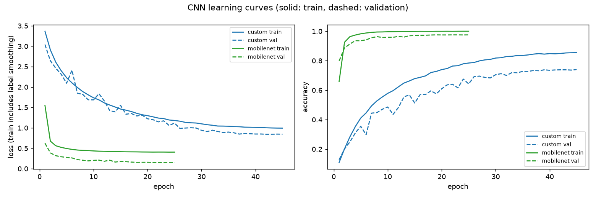
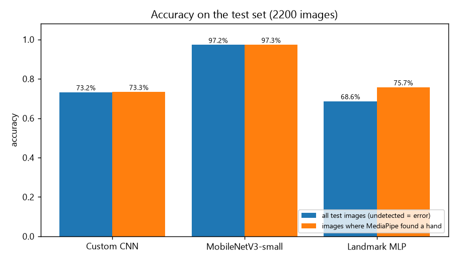
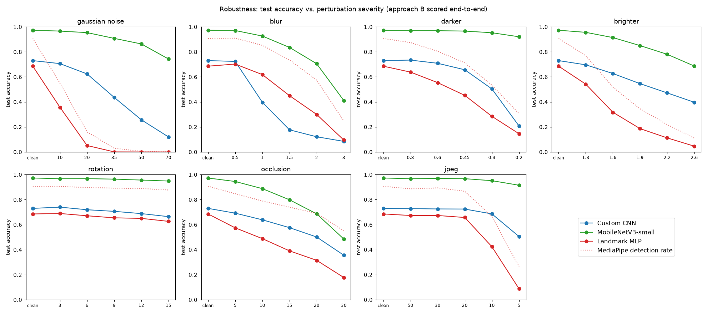
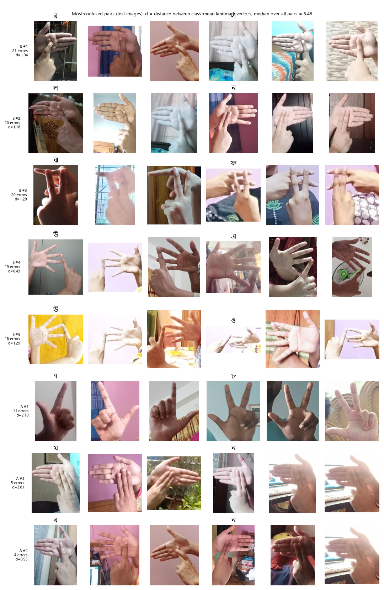
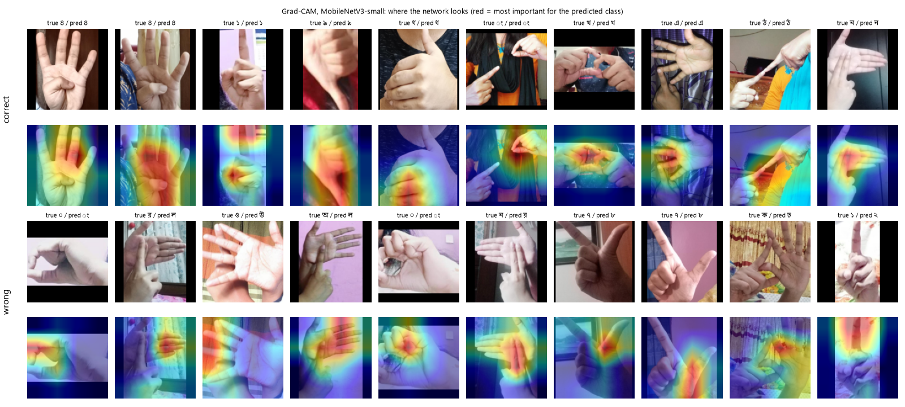

# BdSL Learning Coach: Image CNNs vs. Hand-Landmark MLP for Bangla Sign Language Recognition

*Neural Network Lab project. Yousuf Sharif Fahim, Dept. of CSE, BUBT. November 2026.*

> **Status of this report.** Every number comes from a file in `results/` produced by a script in `src/`. Two items are **pending** and clearly marked: (1) evaluation on the author's own webcam photos (Section 6.3), and (2) verification of the class-to-letter mapping by a BdSL-literate reader (Section 2.1). The live demo URL is added after deployment.

## Abstract

We compare two neural-network approaches for recognising 49 static Bangla Sign Language signs (letters, digits and special signs) from the BDSL 49 dataset:
- **(A)** convolutional networks on raw images: a 401k-parameter CNN trained from scratch, and a fine-tuned ImageNet-pretrained MobileNetV3-small
- **(B)** MediaPipe hand landmarks, normalised into a 131-number vector and classified by a 74k-parameter MLP trained from scratch

The dataset stores images in capture order, so a random split would leak near-copies of test images into training: a colour-histogram nearest-neighbour baseline scores 41.9% under a random split but 17.4% under ours. We therefore build a leakage-aware 70/15/15 split from contiguous capture blocks and remove near-duplicates across splits.

On the held-out test set (2,200 images, evaluated once):
- **MobileNetV3-small: 97.2% accuracy** (95% CI 96.6–97.9)
- **Custom CNN:** 73.2%
- **Landmark MLP:** 75.7% on the 90.7% of images where MediaPipe detects a hand, but 68.6% end-to-end

Size and speed:
- The MLP is the smallest and fastest classifier: 0.3 MB and 0.05 ms per image.
- But it depends on MediaPipe (7.6 MB, about 15 ms per image).

In robustness tests (noise, blur, lighting, rotation, occlusion and JPEG compression), MobileNet stayed the most accurate at every severity. Approach B's losses come mostly from MediaPipe failing to detect the hand. Its errors concentrate on two-handed "contact" signs whose landmark patterns are nearly identical.

We ship approach B as a fully static, self-hosted in-browser demo with automated Python/JavaScript parity tests. We discuss the case for a hybrid MediaPipe-crop + MobileNet model as future work.

## 1. Introduction

Bangla Sign Language (BdSL) is used by deaf communities in Bangladesh, but there are few tools that help hearing people learn it. This project builds a browser-based learning aid that recognises static BdSL hand signs from a webcam. Behind it is a small, controlled comparison of two neural-network approaches trained on the same data with the same splits:

- **Approach A, image CNNs:** a convolutional network reads the raw pixels. We train a small custom CNN from scratch and fine-tune an ImageNet-pretrained MobileNetV3-small.
- **Approach B, landmarks + MLP:** Google's MediaPipe Hand Landmarker turns each image into 21 3D keypoints per hand, and a small multilayer perceptron (MLP), trained from scratch, classifies the normalised keypoints.

The questions are: which approach is more accurate, and what does each cost in model size, speed and robustness? The better trade-off is shipped as a static web app. It runs entirely in the browser, so the camera feed never leaves the device.

## 2. Dataset

### 2.1 BDSL 49
We use the **Recognition** part of BDSL 49 [1]: cropped hand-sign photos in 49 classes. These are the paper's labels 1–49, covering Bangla letters, the digits ০–৯ and the special signs ং, ঃ, ্ and "space". The photos were taken with smartphone cameras by 14 adult signers in their own surroundings. The paper also contains a Detection part (full frames with bounding boxes), which we don't use.

The audit (`src/audit_data.py`, `results/audit_summary.json`) found:
- **14,714 JPEG images**, none corrupt
- **296–319 images per class**, a max/min ratio of 1.08, so class weights aren't needed (`results/class_counts.png`)
- very varied sizes, from 42 px to 5,570 px on a side, because the images are tight crops

Folder `k` holds files named `(k+1)_<index>.jpg`, where `k+1` is the paper's label number. We mapped classes to Bangla characters from the paper's Table 1 (`data/processed/labels.json`). The per-class counts match exactly half of Table 1's totals, and the digit classes show the expected finger counts (`results/sample_grid.png`). **The mapping is still to be verified by a BdSL-literate reader.**

### 2.2 Leakage and how the split handles it
File names carry no signer ID, so a signer-grouped split isn't possible. But images are stored in capture order: image similarity, both structural (pHash) and colour/background, falls steadily with the index gap and levels off at about 20–25 images (`results/leakage_gap_curve.png`). Neighbouring images are effectively the same person, background and pose a moment apart. We also found 1,424 near-duplicate pairs (pHash distance ≤ 8 of 64), 5 of them pixel-identical (`results/leakage_report.json`).

A random split would therefore put near-copies of test images into training. We measured the effect with a deliberately "dumb" model: 1-nearest-neighbour on colour histograms, with no information about hand shape at all. **It scores 41.9% on a random split but 17.4% on our grouped split** (chance is 2.0%) (`results/leakage_knn_demo.json`).

Our split (`src/make_splits.py`, `data/processed/splits.csv`):
1. Group each class into blocks of 15 consecutive images, a stand-in for one signer or session.
2. Per class, give contiguous runs of blocks to test (≈15%), then validation (≈15%), then train, starting from a random rotation (seed 42).
3. Where a near-duplicate pair still crosses two splits, exclude the member in the larger split: 228 images (1.5%).

Result: **10,109 train / 2,177 validation / 2,200 test** (68.7 / 14.8 / 15.0%), with no near-duplicate pair crossing splits (`results/split_summary.json`). Residual risk: a signer can straddle a block boundary. 10.6% of test images have a same-class training image within 5 indices, versus 100% under a random split. The test set was used exactly once (Section 5).

## 3. Methods

### 3.1 Approach A: CNNs on images
- **Input:** each image is letterboxed (aspect ratio kept, black padding) to 144×144 and cached. Training uses random 128×128 crops, random rotation of ±10°, and colour jitter (brightness, contrast and saturation ±30%, small per-channel gain). There's no horizontal flip, because flipping swaps the hands and can change a sign's meaning. Evaluation uses a centre 128×128 crop. Pixels are normalised with ImageNet statistics (`src/cnn_data.py`).
- **Custom CNN:** four blocks of conv 3×3 → BatchNorm → ReLU → max-pool (32, 64, 128, 256 channels), then global average pooling, dropout 0.3 and a linear layer to 49 classes: 401,489 parameters. A two-conv-per-block version was planned, but at about 73 min of training on our CPU it exceeded the time budget (`results/cnn_time_estimates_two_conv_custom.json`).
- **MobileNetV3-small:** ImageNet-pretrained, with a new 49-class output layer, and all layers fine-tuned: 1,568,081 parameters.
- **Training:** AdamW (lr 1e-3 custom, 5e-4 MobileNet; weight decay 1e-4), cosine learning-rate schedule, label smoothing 0.05, batch 64. Early stopping keeps the epoch with the lowest validation loss (`src/train_cnn.py`). MobileNet ran up to 25 epochs (patience 6; best epoch 23). The custom CNN was still improving at epoch 25 (66.1% validation accuracy), so it was retrained for up to 45 epochs (patience 8; best epoch 42, 54 min) (`results/cnn_val.json`, `results/cnn_custom_history_25ep.csv`).

### 3.2 Approach B: MediaPipe landmarks + MLP
- **Landmarks:** MediaPipe Hand Landmarker (Tasks API, image mode, up to 2 hands) on each image, resized to at most 640 px and padded with a 25% black border. The padding gives the palm detector the context it expects. On a 392-image train/validation sample, padding plus a confidence threshold of 0.3 raised the detection rate from 75.0% to 90.6% (`results/landmark_detection_settings.json`).
- **Normalisation** (`normalize_hands()` in `src/landmarks.py`): convert to pixel units, move the wrist to the origin, divide by the wrist-to-middle-knuckle distance, and mirror a single left hand so it looks like a right hand. With two hands, order them left-to-right without mirroring, and append the second wrist's offset relative to the first. The result is a **131-dimensional feature vector**: 63 + 63 coordinates, 2 presence flags and a 3-number offset.
- **Classifiers** (`src/train_landmark_mlp.py`): logistic regression and a random forest as classical baselines, and an MLP 131 → 256 → 128 → 49 (BatchNorm, ReLU, dropout 0.3; 73,777 parameters). The MLP is trained with AdamW (lr 1e-3), batch 128 and early stopping on validation loss (patience 30). Augmentation on the landmark coordinates: rotation ±15°, independent x/y scaling 0.9–1.1, and Gaussian noise σ = 0.02.
- **Undetected images** (no hand found) are left out of MLP training. At test time we report accuracy both on detected images and end-to-end, with every detection failure counted as an error.

### 3.3 Experimental setup
Everything uses seed 42 and runs on a CPU: AMD Ryzen 5 7500F (6 cores), no GPU, Python 3.13, PyTorch 2.15, MediaPipe 1.2.3 (`results/environment.json`). Model selection uses only the validation set. Latency is measured on the CPU with batch size 1 and one PyTorch thread, as the median of 200 runs after warm-up (`src/evaluate.py`).

## 4. Validation results (model development)

All model choices were made on the validation set (`results/landmark_mlp_val.json`, `results/cnn_val.json`).

| Model | Val accuracy | Note |
|---|---|---|
| Logistic regression (landmarks) | 73.5% | detected images |
| Random forest (landmarks) | 72.1% | detected images |
| MLP, no augmentation | 77.3% | detected images |
| **MLP + landmark augmentation** (selected) | **79.0%** | 70.4% counting undetected images as errors |
| Custom CNN (45 epochs) | 73.8% | |
| MobileNetV3-small | 97.5% | |

Notes on the landmark models:
- The MLP adds 5.5 points over logistic regression, and augmentation adds 1.7 more.
- The MLP barely overfits: train and validation curves track each other (`results/landmark_mlp_curves.png`).
- Wider networks didn't help: 512–256 hidden units scored 77.6% and 77.0% (`results/landmark_mlp_capacity.json`). So the limit is the information in the landmarks, not model capacity.

Notes on the CNNs:
- MobileNet reached 96% validation accuracy after 3 epochs (`results/cnn_curves.png`), which shows the effect of ImageNet pretraining.

*Figure 1. CNN learning curves (custom CNN: 45 epochs; MobileNet: 25).*

## 5. Test results (single evaluation)

The test split (2,200 images) was evaluated once, with `src/evaluate.py` (`results/comparison.csv`). The 95% intervals come from 2,000 bootstrap resamples of the saved predictions (`results/comparison_ci.csv`).

| | Custom CNN | MobileNetV3-small | Landmark MLP |
|---|---|---|---|
| Accuracy, all 2,200 test images | 73.2% [71.2, 75.0] | **97.2%** [96.6, 97.9] | 68.6% [66.8, 70.6] (undetected = error) |
| Accuracy, 1,995 images with a detected hand | 73.3% | 97.3% | 75.7% [73.8, 77.5] |
| Macro F1, all images | 0.728 | 0.972 | 0.712 |
| Parameters | 401,489 | 1,568,081 | 73,777 |
| Model file | 1,580 KB | 6,245 KB | 297 KB **+ 7,636 KB** MediaPipe model |
| Latency, classifier only (CPU, batch 1, 1 thread) | 4.20 ms | 2.56 ms | 0.05 ms |
| Latency, end-to-end incl. MediaPipe | n/a | n/a | 15.4 ms |

*Figure 2. Test accuracy on all images and on the subset where MediaPipe found a hand.*

**Interpretation** (`results/comparison_interpretation.md`):
- **MobileNet clearly wins on accuracy:** +24.1 points over the custom CNN (CI 22.2–26.0).
- **On images with a detected hand, the landmark MLP and the custom CNN are statistically tied:** +2.4 points, CI −0.1 to +5.0. The MLP gets there with 1/5 the parameters of the custom CNN.
- **End-to-end, the MLP falls 4.6 points behind the custom CNN** (CI −7.0 to −2.0), because MediaPipe found no hand in 9.3% of test images.
- **Size and speed depend on what you count.** The MLP classifier is the smallest and fastest, but the full approach B, including MediaPipe, is larger than MobileNet and slower per image.
- **A caveat in B's favour:** the CNN timings assume a pre-cropped hand. A webcam CNN application would also need a hand detector.
- Validation and test scores agree closely for all models, so selecting models on the validation set didn't overfit it.

## 6. Robustness

### 6.1 Synthetic perturbations
Each test image (shrunk to at most 640 px) was perturbed at 5 severities. The perturbations were Gaussian noise, blur, darkening, brightening, rotation up to 15°, grey occlusion squares and JPEG compression (`results/robustness_examples.png`). MediaPipe was re-run on each perturbed image, and approach B was scored end-to-end (`src/robustness.py`, `results/robustness.csv`).

*Figure 3. Test accuracy vs. severity. The dotted line is MediaPipe's detection rate.*

Accuracy drop from clean to severity 3, in percentage points (`results/robustness_summary.csv`):

| Perturbation (severity 3) | Custom CNN | MobileNet | Landmark MLP | MediaPipe detection |
|---|---|---|---|---|
| Gaussian noise σ = 35 | −29.4 | −6.5 | −68.5 | 3.0% |
| Blur (1.5% of image size) | −55.3 | −13.7 | −23.5 | 73.6% |
| Darker (×0.45) | −7.3 | −0.7 | −23.3 | 71.2% |
| Brighter (×1.9) | −18.4 | −12.3 | −49.9 | 34.5% |
| Rotation 9° | −2.4 | −0.9 | −3.1 | 89.2% |
| Occlusion 15% | −15.4 | −17.4 | −29.5 | 74.0% |
| JPEG quality 20 | −0.5 | −0.5 | −2.8 | 86.7% |

**MobileNet keeps the highest accuracy at every severity of every perturbation** (`results/robustness.csv`). At severity 3 it also has the smallest drop for every perturbation (tied with the custom CNN for JPEG), except occlusion, where the custom CNN drops slightly less (−15.4 vs −17.4) from a much lower starting point. This contradicts our initial hypothesis that background-free landmark features would be more robust.

The reason shows in the detection column. Approach B is a two-stage pipeline, and its first stage, MediaPipe hand detection, fails under noise and over-exposure. When a hand *is* detected, the MLP's accuracy holds up much better:
- 75.6% on clean images
- 61.1% (blur), 63.5% (darker), 73.4% (rotation) and 75.8% (JPEG) at severity 3

So the weakness is mainly detection, not classification. The custom CNN, trained only on our small dataset, is the most fragile under blur and noise.

One caveat: many dataset crops are small, so per-pixel noise is coarse on them. The noise test may be harsher than real camera-sensor noise.

### 6.2 Web pipeline parity
The browser re-implements preprocessing in JavaScript. On 20 validation samples (with 0, 1 and 2 hands), automated tests show (`results/onnx_parity.json`, `results/web_parity.json`):
- JS features match Python exactly
- ONNX Runtime Web logits differ from PyTorch by at most 7.6×10⁻⁶
- MediaPipe JS and MediaPipe Python find the same number of hands on 20/20 images and give the same prediction on 16/16 images with detections

A headless-browser smoke test of the built site with a fake camera confirms the models load, frames are processed, and **no request leaves the local host** (`results/web_smoke.json`).

### 6.3 Own webcam photos: PENDING
`src/capture_own.py` captures about 10 photos for each of about 10 signs by a new person in a new room. `src/eval_own.py` then evaluates all three models on them, which is a genuine out-of-distribution test. **These photos haven't been taken yet. `results/own_eval.json` currently reads `"status": "PENDING"`, and no result is reported here.**

## 7. Error analysis

Sources: `src/error_analysis.py` and `results/error_analysis.md`.

*Figure 4. Most-confused sign pairs. d is the distance between class-average landmark vectors (median over all pairs: 5.48).*

**Approach B.** The landmark MLP's top confusions are among two-handed "contact" signs, where a finger of one hand touches a different spot on the other hand (`results/confused_pairs.csv`):
- র-ল (21 errors), ল-ন (20), ঝ-ফ (20), উ-এ (19), উ-ও (18)

In landmark space these pairs are among the closest 1% of all 1,176 class pairs. উ-এ, at 0.43, is the single closest (`results/landmark_class_distances.json`). The errors are spread across 4–6 capture blocks per pair, so the signs really are hard to tell apart from landmarks; it isn't one bad session.

**Approach A.** MobileNet's largest confusion is ৭→৮ (11 errors, one direction). 6 of those fall in a single 15-image capture block, which suggests a session-specific effect.

Grad-CAM on 10 correct and 10 wrong MobileNet predictions puts the network's attention on the hands and fingers rather than the background (`results/gradcam.png`). That's supportive but qualitative evidence that it learned hand shape.

Per-signer accuracy isn't possible without signer IDs. Per capture block (152 test blocks, `results/per_block_accuracy.png`):
- MobileNet: median 1.00, minimum 0.60
- the two weaker models: medians around 0.8, with some blocks at 0%

*Figure 5. Grad-CAM for MobileNetV3-small: top two rows correct, bottom two rows wrong predictions.*

## 8. Limitations
- **Static alphabet/digit signs only.** Real BdSL uses motion, two-handed dynamics and facial grammar. This system recognises single static handshapes.
- **Limited signers.** 14 signers, all of whom appear in train, validation and test (in different capture sessions). Signer IDs aren't available, so we couldn't test on unseen signers. Scores on new people may be lower, especially for the CNNs, which can exploit person and background cues. The own-webcam test (pending) is a first check.
- **Imperfect leakage control.** Grouping uses capture-order blocks as a stand-in for signer or session. 10.6% of test images still have a same-class training image within 5 indices.
- **MediaPipe detection failures.** 9.3% of test images had no detected hand. Detection collapses under noise and over-exposure. The landmark features also blur fine two-hand contact differences.
- **Single run.** One split and one seed (42). The confidence intervals cover test sampling only, not training variance.
- **Label mapping is provisional.** It was transcribed from the dataset paper and checked against digit handshapes, but not yet verified by a BdSL-literate reader.
- **Compute budget.** The custom CNN was simplified (one conv per block) to train on a CPU within the time budget.
- **A learning aid, not an interpreter.** The demo gives practice feedback on isolated signs. It must not be used as a replacement for human interpreters.

## 9. Conclusion
On BDSL 49, a fine-tuned pretrained CNN (MobileNetV3-small) is the clear winner: 97.2% test accuracy, and the highest accuracy under every image perturbation we tested. The landmark approach shows what a tiny model can do: 74k parameters, a 0.3 MB file and 0.05 ms per prediction, and it ties a from-scratch CNN when a hand is detected. But it depends on MediaPipe, which brings 7.6 MB and about 15 ms per frame, and which fails on 9% of clean test images and on most noisy or over-exposed ones.

Two methodological lessons generalise beyond this project:
- **Leakage-aware splitting matters.** A random split would let even a colour-only baseline gain 24 points.
- **A two-stage pipeline is only as strong as its first stage.**

We ship approach B as a private, fully in-browser demo because its features are background-independent and it already provides the hand skeleton. The evidence suggests the next step is a hybrid: MediaPipe to find and crop the hand, then a pretrained CNN to classify it, validated on new signers.

## References
1. A. Hasib, J. F. Eva, S. S. Khan, M. N. Khatun, A. Haque, N. Shahrin, R. Rahman, H. Murad, M. R. Islam, M. R. Hussein. "BDSL 49: A comprehensive dataset of Bangla sign language." *Data in Brief* 49 (2023) 109329. doi:10.1016/j.dib.2023.109329.
2. F. Zhang, V. Bazarevsky, A. Vakunov, A. Tkachenka, G. Sung, C.-L. Chang, M. Grundmann. "MediaPipe Hands: On-device Real-time Hand Tracking." arXiv:2006.10214, 2020.
3. A. Howard et al. "Searching for MobileNetV3." *ICCV* 2019.
4. R. R. Selvaraju et al. "Grad-CAM: Visual Explanations from Deep Networks via Gradient-based Localization." *ICCV* 2017.
5. I. Loshchilov, F. Hutter. "Decoupled Weight Decay Regularization" (AdamW). *ICLR* 2019.
